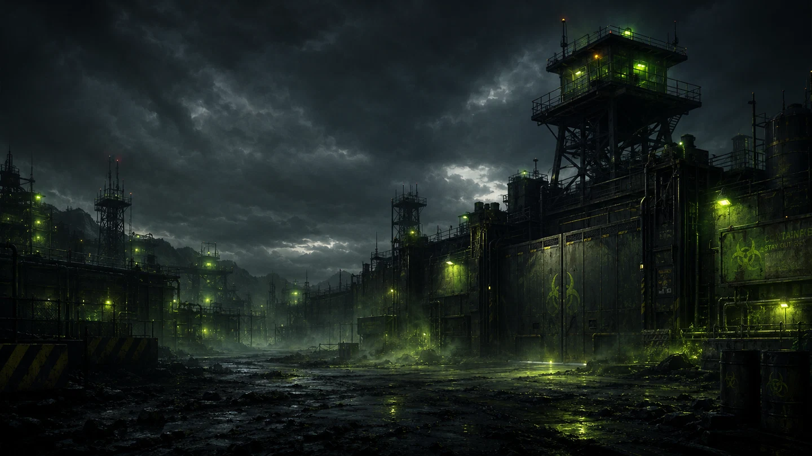
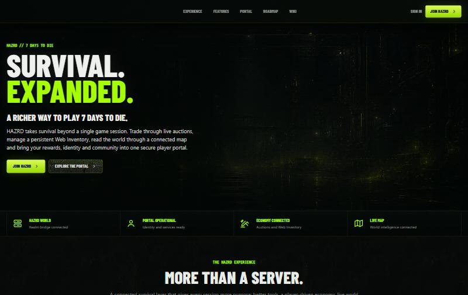
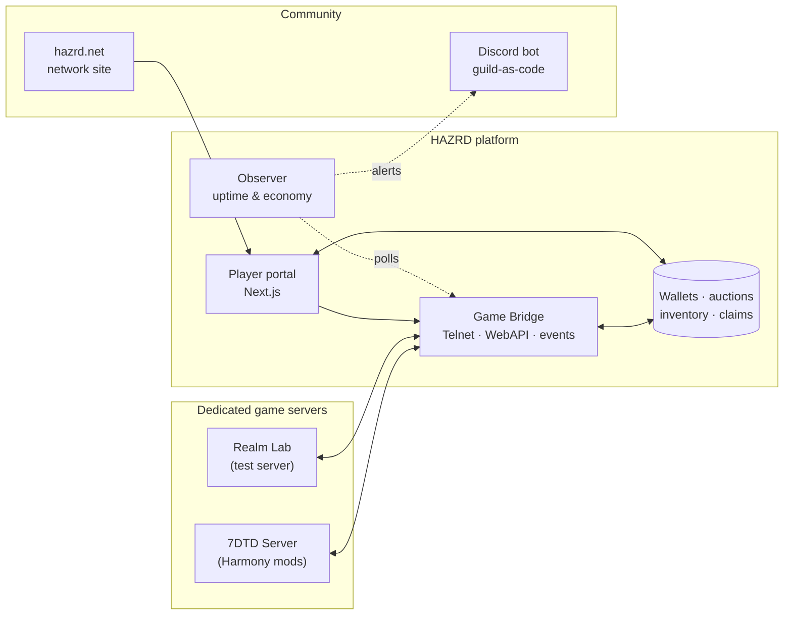
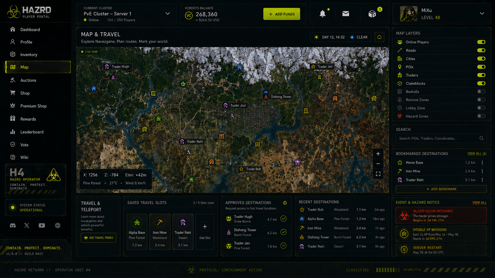
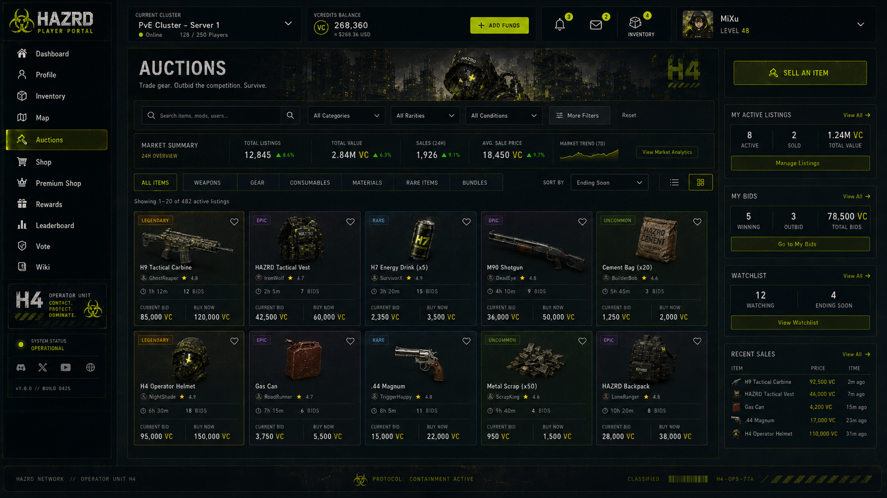

  

<h1 align="center">HAZRD Platform</h1>

  <b>A web & ops platform layer on top of dedicated survival game servers.</b> 
  Player portal · live map · auctions · web inventory · Discord-as-code · monitoring

  
  

> This is a **showcase repository**. The platform runs live game economies, so the source code is private.
> Here you'll find what HAZRD is, how it's built and the engineering decisions behind it.

---

## 🧟 The idea

Survival games like *7 Days to Die* are great — until the endgame: grind, crowded maps, wipes, one server as the whole world.
HAZRD adds a **second layer on top of the game**: a persistent player portal where your identity, items and progress live outside a single session.

- 🗺️ **Live map** — players, claims and zones rendered on the real world map
- 💰 **Economy** — live auctions and a shop that deliver items straight into the game
- 🎒 **Web inventory** — buy or win items on the web, claim them in-game when you're ready
- 🏆 **Seasons, rewards & leaderboards** — progression beyond one wipe
- 💬 **One Discord for the whole network** — generated from config, not clicked together

   
  Live: <a href="https://7days.hazrd.net">7days.hazrd.net</a>

---

## 🏗️ Architecture

| Component | What it does | Stack |
| --- | --- | --- |
| **Player portal** | Map, auctions, shop, web inventory, profiles, leaderboards, wiki | Next.js · TypeScript · Leaflet |
| **Game bridge** | Talks to the game server (Telnet/WebAPI), delivers items, streams game events | Node.js |
| **Server mods** | Server-side game hooks for chat, delivery and events — no client mod required | C# · Harmony |
| **Discord bot** | Generates roles, channels and game spaces from one YAML registry with plan → apply | Node.js · Discord.js |
| **Observer** | Uptime + economy history, Discord alerts, small control panel | Node.js · SQLite |
| **Network site** | Masterbrand site for all games | Next.js · Cloudflare |

---

## 🔧 Engineering highlights

A few problems that were more interesting than they looked:

**Live map without melting bandwidth.**
Map markers are live, but the terrain tiles only change when players build. A naive "redraw every N seconds" looked like a live map in code and did *nothing* — Leaflet rebuilds the `` and the browser serves identical URLs from memory cache, so no request ever leaves.
Solution: ETag/304 on tiles plus a tiny version endpoint the client polls once a minute. Only when it changes does the tile URL get a new cache-buster — instead of ~400 KB per tick per tab.

**Discord as infrastructure.**
The whole guild (roles, categories, channels, permissions, onboarding) is declared in config. Adding a game is a registry entry → validate → plan → apply on staging → apply on production. Destructive changes need an explicit flag.

**Game updates are a deployment, not a click.**
All server mods patch game methods at runtime. A game update can change a signature and crash the server on start instead of failing cleanly — so updates go through the test realm first and are never auto-applied to the live server.

**Bridge topology.**
Today: one bridge sidecar per game server (simple, isolated). Next: one bridge for the whole cluster as the single source of truth for wallets, auctions and zones — which also unlocks cluster-wide chat.

---

## 🎨 Design concepts

  
  

Concept designs for the player portal — map & travel, auctions. Not all shown features are live yet.

---

## 🧭 Roadmap

- [x] 7 Days to Die player portal, live map & markers
- [x] Discord network with guild-as-code
- [x] Monitoring & alerting (Observer)
- [ ] Shop → in-game item delivery
- [ ] Warps, homes & map overlays
- [ ] Cluster-wide bridge & chat
- [ ] Palworld as the second game

---

  Built by <a href="https://github.com/mixu-94">@mixu-94</a> · part of the <a href="https://github.com/HAZRD-Network">HAZRD Network</a> · <a href="https://hazrd.net">hazrd.net</a>

